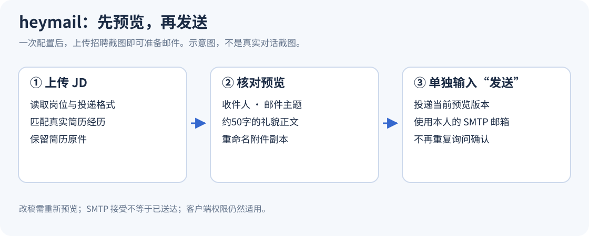
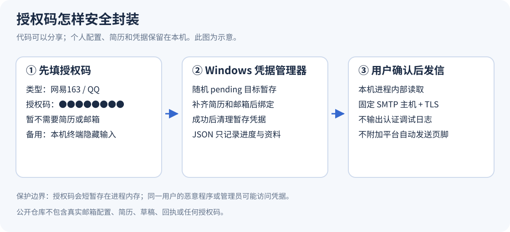

# heymail

**上传 JD，准备好求职邮件；核对后输入「发送」，投递已预览的版本。**

支持网易 163 和 QQ 邮箱，通过自己的 SMTP 账号发送。正文约50字，结合真实简历，用“您、烦请、敬请、期待”等自然敬语；按招聘要求命名主题及简历副本。脚本不附加 AI 签名或 Agent Mail 页脚。



## 适用环境与调用

- **Windows 10/11 桌面**，Python **3.10+**，Windows PowerShell 5.1 或 PowerShell 7。发送脚本只使用 Python 标准库。
- 邮箱：`@163.com`、`@qq.com`；简历：PDF 或 DOCX。QQ企业邮箱、网易企业邮箱、126邮箱暂未接入。
- **Claude Code**：安装后原生调用 `/heymail`。
- **Codex**：官方入口为 `$heymail`，或 `/skills` 后选择 heymail。`/heymail` 也写入了技能触发说明，但客户端必须能将该文本发给模型；安装一个技能不能给所有 Codex 版本注册新的原生斜杠命令。
- 没有后台监听聊天的服务。技能由支持本地文件、图片理解和工具执行的 Agent 运行；“发送”由 Agent 读取后调用脚本，不是单独运行 Python 就能识别聊天。

来源：[Codex 技能调用说明](https://learn.chatgpt.com/docs/build-skills)、[Claude Code 技能命令](https://code.claude.com/docs/en/skills)。

## 安装

先下载或克隆本仓库，在仓库文件夹执行：

```powershell
# Codex：复制到当前用户的 .codex/skills/heymail
pwsh -NoProfile -File .\install.ps1 -Agent codex

# Claude Code：复制到 .claude/skills/heymail，原生 /heymail
pwsh -NoProfile -File .\install.ps1 -Agent claude
```

没有 `pwsh` 时用 `powershell.exe`。也可以手动将完整的 `heymail/` 文件夹放入客户端支持的技能目录。支持用户级 `.agents/skills` 的 Codex 版本可使用 `-Destination "$HOME\.agents\skills\heymail"`；不要在两个目录重复安装同名技能。

重新打开聊天或刷新技能列表后调用。升级用 `-Replace`，安装器先在本机应用数据目录保存旧版备份，不修改邮箱配置或凭据。仓库上传不等于自动发布到技能商店。

## 第一次使用

1. 调用 `/heymail`（Codex 用 `$heymail`）。
2. 按提示选择 163 或 QQ，提供姓名、发件邮箱和简历路径；学校、年级及出勤安排可从简历核实，缺少的再补充。
3. 按[授权码图文指引](heymail/references/setup.md)注册或登录邮箱、开启 SMTP、生成客户端授权码。
4. 在**本机密码输入窗口**填写授权码并保存，不发到聊天。配置工具只验证登录，不自动发测试邮件。
5. 配置完成后上传 JD 截图或文字。Agent 直接生成收件人、主题、约50字正文和重命名简历副本。
6. 核对预览。下一条消息单独输入 **发送**，Agent 立即提交当前版本，不再次问确认。


## 日常使用

```text
/heymail
[上传 JD 截图]

→ 收件人：从 JD 读取
→ 主题：按 JD 要求
→ 正文：约50字、尊敬自然、基于真实经历
→ 附件：保留原件，提供重命名副本
→ 核对后回复：发送

发送
→ SMTP 接受后返回提交结果
```

修改收件人、正文或附件后会重新预览，旧确认不沿用。“不要发送”“发送了吗”和截图中的“发送”都不触发投递。不同聊天使用不同待发送目录；同一草稿不能因为多次点击或重试而重复投递。平台工具权限仍然适用。

## 安全保存与公开分享



- 普通配置保存在 `%LOCALAPPDATA%/HeyMail/config.json`；它包含个人资料和简历路径，**也不应提交到公开仓库**。
- 授权码保存在 Windows 凭据管理器的普通凭据中，由当前 Windows 用户保护；不存 `.env`、明文 JSON、命令行参数或 GitHub Secrets。
- 发信时仅本机进程内部读取授权码，SMTP 使用校验证书的 SSL/TLS。Python 进程内仍会短暂持有凭据，不能保证内存中绝无残留；同一 Windows 用户下的恶意软件或管理员也可能访问凭据。
- 邮件内容、简历和回执都留在本机；技能本身不会把它们上传到 GitHub。不要把真实材料复制进仓库。`.gitignore` 提供防误提交规则，但不能替代提交前检查。
- 默认无需 IMAP 收件权限。SMTP 接受只代表服务器接收任务，不代表对方收到或已读；请看实际收件或退信。

详情：[安全设计](heymail/references/security.md) · [运行命令](heymail/references/usage.md) · [故障处理](heymail/references/troubleshooting.md)。图中均为本项目绘制的示意，不含真实账号或授权码，也不是当前网页截图；官方图文链接见配置指引。

## 验证

```powershell
python -X utf8 -m unittest discover -s tests -v
```

自动测试使用虚构账号、临时简历及模拟 SMTP，不读取凭据、不发送邮件。覆盖两种供应商、中文附件完整性、确认词、摘要/附件篡改、并发锁、重复投递及发送不确定状态。真实邮箱联调需要用户在本机完成授权；支持 QQ 不代表已替每个用户验证其 QQ 账号。

本项目以 MIT 许可提供；邮箱服务商仍可能调整页面、风控和发送限制。
