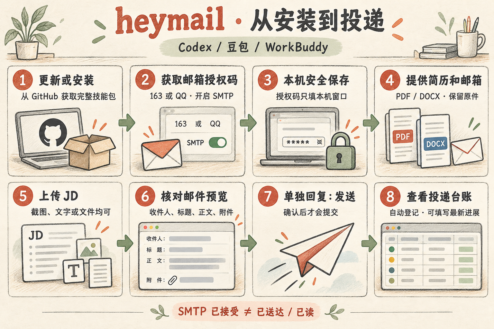
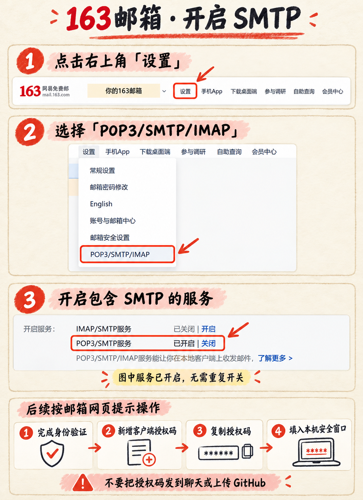
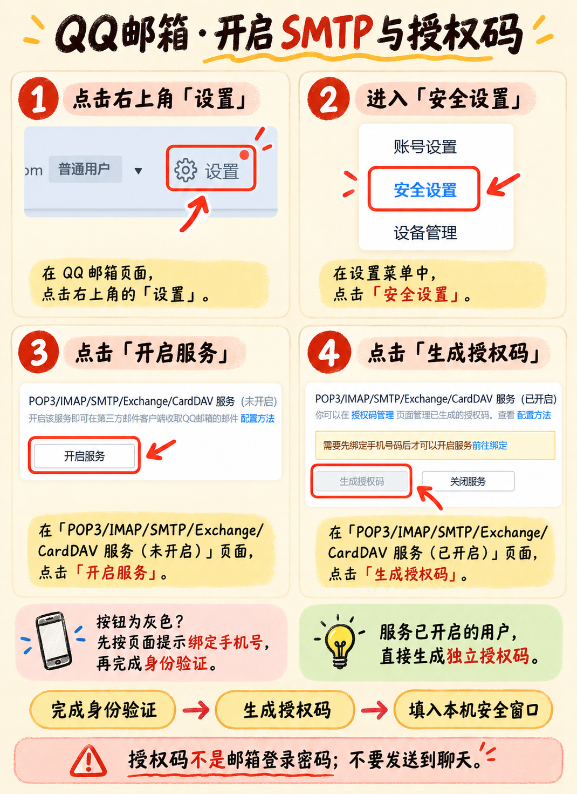
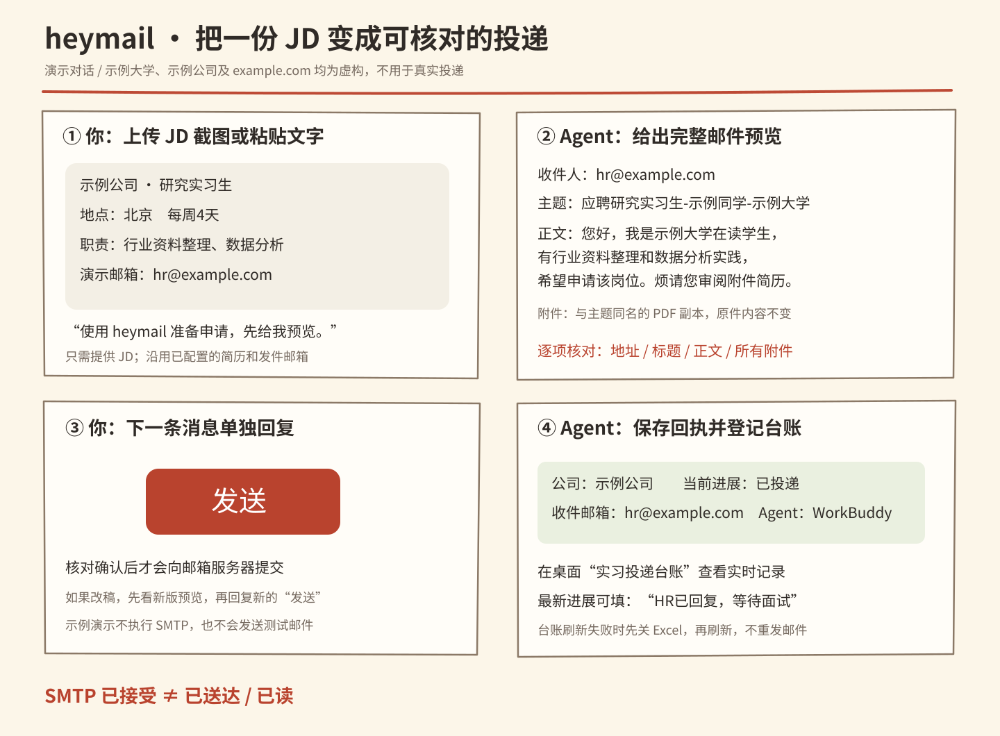

# heymail 安装、更新与投递全流程

Windows 10/11 · Codex / 豆包 / WorkBuddy / Claude Code · v1.4



本页先介绍已有用户更新，再介绍首次安装。邮箱授权码教程、简历配置和 JD 投递演示都在下方。


## 1. 已有用户：原地更新

> [!IMPORTANT]
> 更新会先备份旧技能。保留邮箱配置、Windows 凭据、默认简历、共享台账和人工填写的最新进展。先保存并关闭 Excel。

把下面整个提示框复制到正在使用的 Agent：

> [!TIP]
> 请从 https://github.com/amberbrook0104/heymail-skill 获取 v1.4 完整技能包，原地更新本客户端的 heymail。先查找实际旧安装目录并备份，避免装出第二份。保留邮箱、Windows 凭据、简历、历史回执、台账目录及人工字段，不重新索取授权码，也不发送测试邮件。更新后按新 SKILL.md 检查依赖、刷新原台账并核对桌面入口。投递 Agent 记录实际客户端名称。只处理本机资料，最后报告安装目录、版本和验证结果。其他客户端只在我明确要求时同步。

希望手动执行时，从[完整安装包](https://github.com/amberbrook0104/heymail-skill/releases/download/v1.4/heymail-v1.4.zip)解压，在包目录中选择一条：

```powershell
powershell.exe -NoProfile -ExecutionPolicy Bypass -File .\install.ps1 -Agent codex -Replace
powershell.exe -NoProfile -ExecutionPolicy Bypass -File .\install.ps1 -Agent doubao -Replace
powershell.exe -NoProfile -ExecutionPolicy Bypass -File .\install.ps1 -Agent workbuddy -Replace
powershell.exe -NoProfile -ExecutionPolicy Bypass -File .\install.ps1 -Agent claude -Replace
```

Codex 同时发现新旧两个目录时会停止，需加 `-Destination "实际使用的技能目录\heymail"`。更新完成后跳至[日常投递演示](#5-日常投递从-jd-到台账)。

## 2. 首次安装：从 GitHub 获取完整包

> [!TIP]
> 请安装 https://github.com/amberbrook0104/heymail-skill 的 v1.4 完整版 heymail，先检查本客户端是否已有安装或配置，避免重复安装。按实际客户端选择路径，完整保留 scripts、references、assets。读取 SKILL.md，先引导我在官方邮箱网页开启 SMTP 并生成授权码，再打开本机安全输入窗口；保存成功后只请我提供 PDF/DOCX 简历，最后再请我提供发件邮箱。只检查 SMTP 登录，不发测试邮件。配置台账时优先沿用已有共享目录，缺少时询问我保存位置。完成后报告安装目录和可用功能，再接着处理我的 JD。

### 方式A：让 Agent 按上面的提示安装

完整包内包含技能、空白台账、图片和教程。请勿只复制一个 SKILL.md。

### 方式B：下载并运行安装器

1. 打开 [GitHub v1.4 发布页](https://github.com/amberbrook0104/heymail-skill/releases/tag/v1.4)。
2. 下载 `heymail-v1.4.zip` 并完整解压。
3. 在含 `install.ps1` 的文件夹打开 PowerShell，选择对应客户端执行：

```powershell
powershell.exe -NoProfile -ExecutionPolicy Bypass -File .\install.ps1 -Agent workbuddy
# 其他客户端把 workbuddy 换成 codex、doubao 或 claude
```

| 客户端 | 默认目录 | 调用方法 |
|---|---|---|
| WorkBuddy | `%USERPROFILE%\.workbuddy\skills\heymail` | 在技能列表启用 heymail，再说“使用 heymail” |
| Codex | `%USERPROFILE%\.agents\skills\heymail`；单一旧安装沿用旧位置 | `$heymail` 或在技能列表选择 |
| 豆包 | 用户目录下 Default 配置的 `.user_skills\heymail` | 要求使用已安装的 heymail |
| Claude Code | `%USERPROFILE%\.claude\skills\heymail` | `/heymail` |

WorkBuddy 也可在“技能 → 添加技能 → 上传技能”中导入发布页的 `heymail-workbuddy.zip`。这个包的根目录直接包含 SKILL.md，不使用完整仓库 ZIP 代替。

### 方式C：直接从 GitHub 下载校验后安装

先下载仓库根目录的 [install-from-github.ps1](https://github.com/amberbrook0104/heymail-skill/blob/main/install-from-github.ps1)，在下载目录执行：

```powershell
powershell.exe -NoProfile -ExecutionPolicy Bypass -File .\install-from-github.ps1 -Agent workbuddy
# 原地更新时追加 -Replace
```

脚本获取 GitHub v1.4 Release 完整包，核对 GitHub 返回的 SHA-256 后调用安装器。安装成功后刷新技能列表或重新打开聊天。文件夹名和界面以当前客户端实际显示为准。

## 3. 开启 SMTP 并获取授权码

授权码是邮箱为第三方客户端生成的密码，SMTP 是发送邮件所用的服务。请先登录自己的[163邮箱](https://mail.163.com/)或[QQ邮箱](https://mail.qq.com/)。

> [!CAUTION]
> 授权码只填写在 heymail 打开的本机隐藏输入窗口中。不要把邮箱登录密码、授权码、短信验证码发到聊天、截图或 GitHub。教程图片已经脱敏，不包含可用授权码。

### 163邮箱



1. 点击邮箱顶部的“设置”。
2. 选择“POP3/SMTP/IMAP”。
3. 开启包含 SMTP 的服务；图中 POP3/SMTP 已开启时不用重复开关。
4. 按网页提示完成本人安全验证，在授权管理处生成/新增客户端授权码。截图没有覆盖最后的生成页面，图中的末尾流程条仅为操作说明。
5. 把授权码填写到本机安全输入窗口。

仅发送邮件可开启 POP3/SMTP 或 IMAP/SMTP 中的一项，heymail 不读取收件箱。页面变化时以[163官方帮助](https://help.mail.163.com/)和实际安全验证提示为准。

### QQ邮箱



1. 点击右上角“设置”，进入“安全设置”。
2. 在 POP3/IMAP/SMTP 服务处点击“开启服务”。
3. 服务已开启时，点击“生成授权码”。
4. 如果按钮灰色且提示绑定手机号，先按页面提示绑定，再由本人完成验证。
5. 将生成的授权码填写到本机安全输入窗口。

图中的“关闭服务”用于停用服务，不是本流程的操作目标。[QQ官方授权码帮助](https://help.mail.qq.com/detail/106/985)。

## 4. 首次配置：逐步提供资料

| 顺序 | 你做什么 | 完成标志 |
|---|---|---|
| ① 保存授权码 | 在本机输入框或独立终端隐藏输入，不发到聊天 | Agent 确认安全保存成功 |
| ② 提供简历 | 上传 PDF/DOCX，或给出本机路径 | 简历副本与原件字节一致 |
| ③ 提供发件邮箱 | 给出与授权码匹配的完整163/QQ地址 | SMTP登录验证成功；没有发送测试邮件 |
| ④ 配置台账 | 选择保存目录；多客户端沿用同一目录 | 生成9列表格及桌面快捷方式 |

WorkBuddy 自带 Python 没有 Tkinter 时会打开独立终端隐藏输入。没看到窗口时，可完整解压后双击 `start-setup-console.cmd`；不要在 Agent 的工具输出区域粘贴授权码。

台账可使用 Node + Artifact Tool，或 Python + openpyxl/Pillow。后者不依赖 Codex；依赖缺少时由 Agent 说明并协助配置，不应虚称已启用台账。详细配置见[执行说明](../heymail/references/usage.md)。

## 5. 日常投递：从 JD 到台账



### 第一步：把JD发给Agent

可上传招聘截图、粘贴招聘文字，或提供本机文件路径。加一句：

> [!TIP]
> 使用 heymail 准备这份 JD 的申请。沿用已配置简历，正文只使用真实经历，展示完整预览后等我回复“发送”。

截图模糊或地点、到岗时间等与已知安排冲突时，Agent 只补问缺失项。无需每次重新配置邮箱。

### 第二步：检查预览

以下仅为演示，不是真实招聘信息。示例地址不能用于实际投递。

> **收件人：** hr@example.com  
> **主题：** 应聘研究实习生-示例同学-示例大学  
> **正文：** 您好，我是示例大学在读学生，有行业资料整理和数据分析实践，希望申请研究实习生岗位。简历随信附上，烦请您审阅。  
> **附件：** 应聘研究实习生-示例同学-示例大学.pdf

检查收件人、邮件标题、正文和全部附件。附件仅改副本文件名，原 PDF/DOCX 内容不修改。主题和附件优先按 JD 要求命名，并剔除招聘来源平台标签。

### 第三步：单独回复“发送”

核对无误后，在下一条消息中只输入：

```text
发送
```

修改正文、收件人或附件后，应先核对新版预览，再回复新的“发送”。“准备发送”“不要发送”或JD截图中的“发送”均不是确认。

### 第四步：查看结果和台账

Agent 返回本地回执，并在桌面“实习投递台账”中登记：公司、岗位、地点、投递时间、实际Agent、收件邮箱、当前进展、最新进展、备注。你可以填写“HR已回复”“已完成一面”等最新进展，刷新后保留。

> [!NOTE]
> “SMTP已接受”只表示邮箱服务器接受提交，不代表对方已收到或已读。Excel正在打开导致刷新失败时，先保留回执，关闭Excel后再刷新，不能因此重新发邮件。

## 6. 常见情况

- 已安装但看不到技能：刷新技能列表或重新打开聊天，核对是否选中了正确工作目录。
- 新电脑：首次配置自己的邮箱与简历，不复制他人的配置、凭据或个人台账。
- 多客户端：技能可分别安装；共享同一台账时始终记录实际Agent，不并发刷新或覆盖同一个打开的Excel。
- 授权码失效：在官方网页重新生成，通过本机安全输入流程更新，不发到聊天。
- 源码与品牌素材在GitHub公开；私人简历、回执、配置、原始截图和真实台账不会进入发布包。
