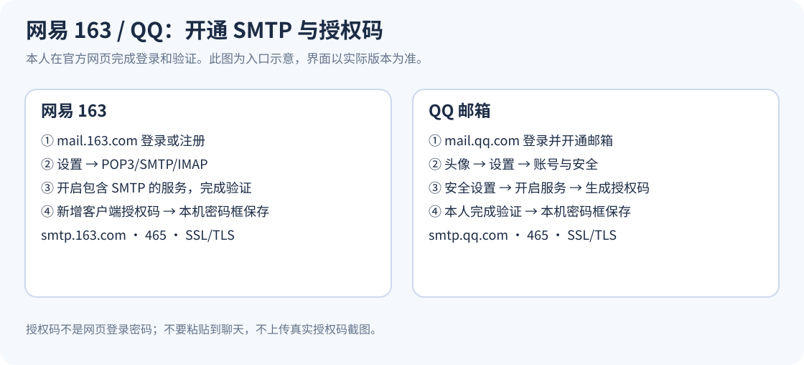

# 首次配置：网易 163 与 QQ

注册/登录邮箱、验证码、扫码和短信验证由本人在官方网页完成。Agent 只提供操作指引和本机输入窗口，不代填身份验证，不获取网页登录密码。

## 1. 注册或登录

| 供应商 | 官方入口 | 说明 |
| --- | --- | --- |
| 网易 163 | [mail.163.com](https://mail.163.com/) | 已有账号直接登录；没有则从官方注册入口按提示办理。 |
| QQ | [mail.qq.com](https://mail.qq.com/) | 使用自己的账号登录并开通邮箱；没有账号则按官方页面完成注册/开通。 |

本版配置账号分别以 `@163.com`、`@qq.com` 结尾；不使用招聘方邮箱作为发件账号。

## 2. 生成客户端授权码

### 网易 163

网页版邮箱 → 设置 → POP3/SMTP/IMAP（有些版本显示 POP/SMTP/IMAP）→ 开启包含 SMTP 的服务 → 本人完成安全验证 → 生成/新增客户端授权密码。

授权码替代邮箱登录密码用于 SMTP。仅为发信可以开启 POP3/SMTP 或 IMAP/SMTP；本技能不要求读取收件箱，也不依赖 IMAP 登录。服务已开启时，在授权管理处新增独立授权码即可；界面名称以当时网页版为准。

图文参考：[华为设备对接 163 的官方指引，含设置和开启服务截图](https://consumer.huawei.com/cn/support/content/zh-cn15872099/)。SMTP 参数交叉核对：[腾讯云 163 配置说明](https://ioa.cloud.tencent.com/support/199262718652653568/)。

### QQ

新版网页版：右上角头像 → 设置 → 账号与安全 → 安全设置 → 开启 POP3/IMAP/SMTP 服务 → 生成授权码 → 本人按提示验证身份。旧版可在“设置 → 账户”找到相应服务。

当前官方帮助说明授权码用于第三方客户端；更改账号密码可能令旧授权码失效。请给本技能单独生成并备注一个授权码，方便撤销。

图文参考：[腾讯官方生成与管理授权码说明，含新版截图](https://help.mail.qq.com/detail/106/985)；[华为设备对接 QQ 的指引，含旧版截图](https://consumer.huawei.com/cn/support/content/zh-cn16108643/)。



不要把授权码截图上传到对话或仓库。指引图片用于寻找入口；真正的验证码和授权码只在自己设备里处理。

## 3. 保存普通配置

Agent 用 `mail.py setup` 保存邮箱、姓名、简历原件路径与有依据的背景信息。授权码不是该命令的参数。

```powershell
# 替换示例值。所有选项均为普通资料，不包含授权码。
python -X utf8 "<skill-dir>/scripts/mail.py" setup --provider 163 --email "你的邮箱@163.com" --name "姓名" --resume "C:/你的目录/简历.pdf" --school "学校" --degree "金融硕士" --grade "研一" --days "4" --months "3个月以上"
```

QQ 改为 `--provider qq --email "你的邮箱@qq.com"`。只有资料明确时才填写出勤、年级和到岗日期；不确定留空。支持 `--start-date`；已有配置需要更新时加 `--replace`，会先生成本地备份。

默认配置：`%LOCALAPPDATA%/HeyMail/config.json`。命令最前可加 `--config "本机配置路径"` 使用独立配置；同一聊天切换账号需要重新准备预览。

## 4. 在本机密码框保存授权码

Agent 打开：

```powershell
pwsh -NoProfile -STA -File "<skill-dir>/scripts/save-credential.ps1" -Provider 163 -Email "你的邮箱@163.com"
```

QQ 使用 `-Provider qq`。没有 `pwsh` 时用 `powershell.exe`。窗口里输入内容显示圆点，点击“安全保存”；此步骤不发邮件。

默认凭据目标为 `HeyMail/163/<发件邮箱>` 或 `HeyMail/qq/<发件邮箱>`，保存到当前 Windows 用户的“凭据管理器 → Windows 凭据 → 普通凭据”。更换电脑/Windows 用户后需要重新填写。配置中 `credential_target` 仅为目标名称，不是授权码。

迁移已有凭据时可在 setup 使用 `--credential-target "既有目标名称"`，并在密码框使用相同 `-CredentialTarget`；无需导出、打印或复制已有授权码。

## 5. 验证 SMTP 登录

```powershell
python -X utf8 "<skill-dir>/scripts/mail.py" status
python -X utf8 "<skill-dir>/scripts/mail.py" check
```

`credential_saved: true` 只表示凭据可访问；`smtp_authenticated: true` 才表示 TLS SMTP 登录成功。都不会自动发邮件。不要为了验证设置而反复投递测试邮件。

| 供应商 | SMTP | 端口 | 加密 | 用户名 | 密码 |
| --- | --- | --- | --- | --- | --- |
| 163 | smtp.163.com | 465 | SSL/TLS，验证证书 | 完整发件邮箱 | 客户端授权码 |
| QQ | smtp.qq.com | 465 | SSL/TLS，验证证书 | 完整发件邮箱 | 客户端授权码 |

脚本从固定映射选择服务器，不接受 JD、配置或附件指定任意 SMTP 主机，防止将凭据交给无关服务器。

## 更新或撤销授权码

在服务商网页的授权码管理中让该授权码失效；这才会撤销服务商侧访问。需要重新使用时生成新码，在本机密码框覆盖保存，再运行 `check`。不必删除并重建邮箱账号。

本机也可在 Windows 凭据管理器删除对应普通凭据；仅删除本机凭据不会撤销服务商侧授权。撤销后的旧草稿须检查账号配置，必要时重新准备；不要自动改用 Agent Mail 发件。
